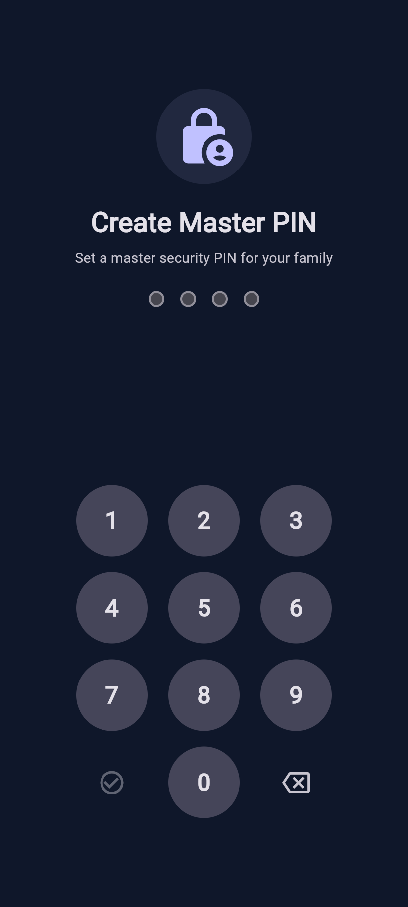
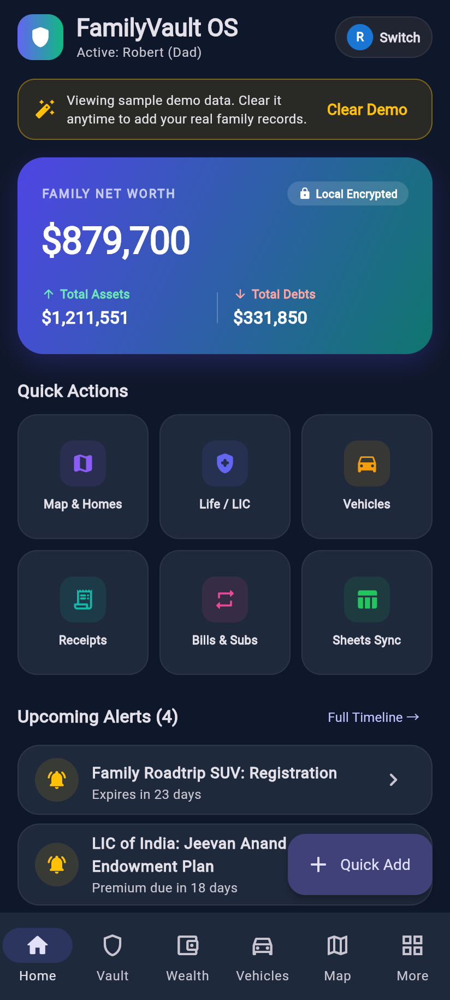
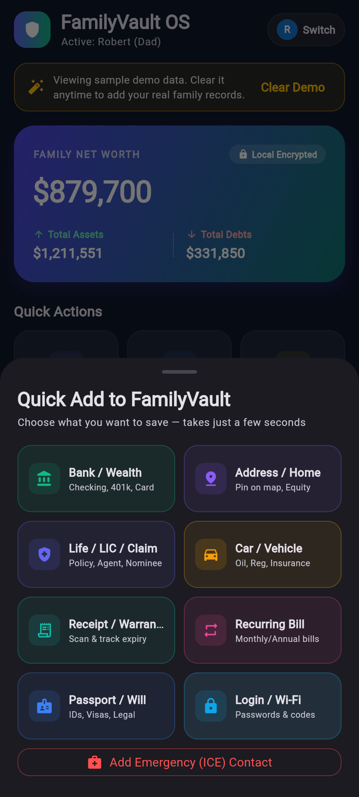
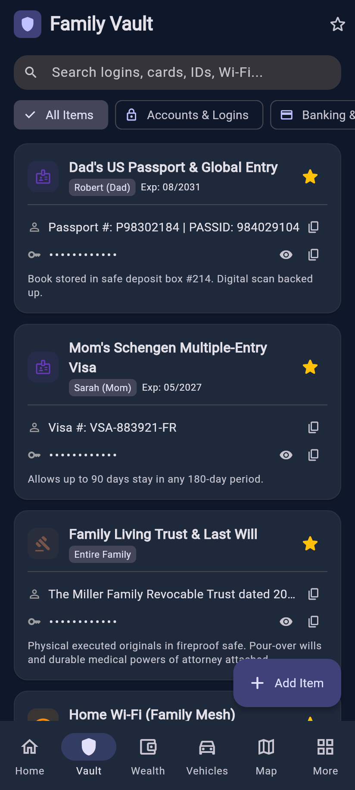
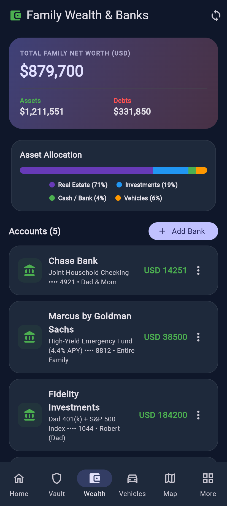
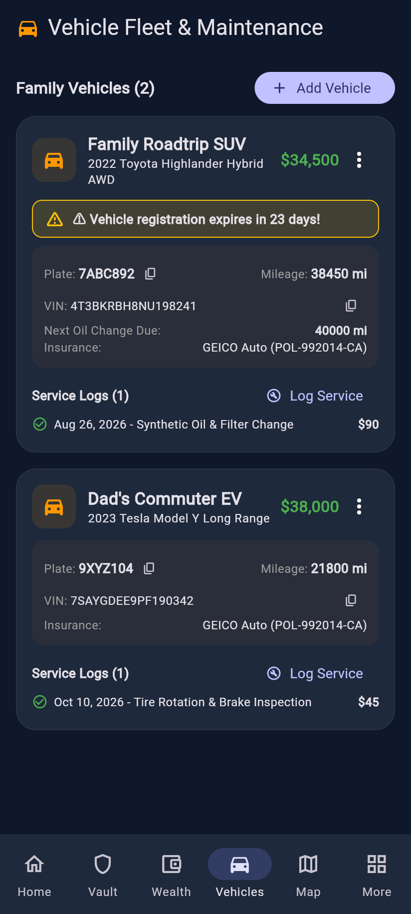
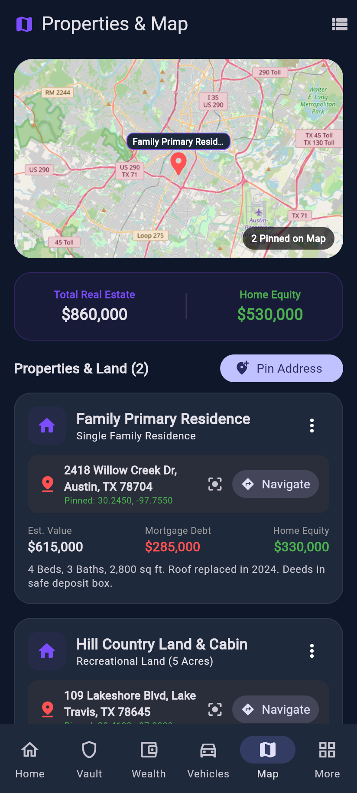
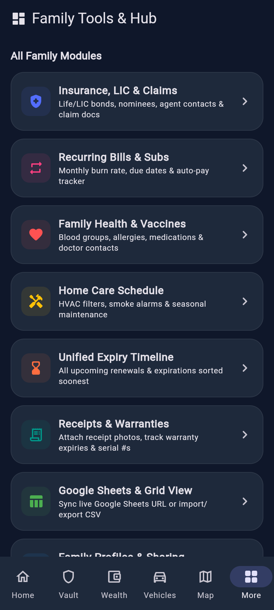

# FamilyVault OS 🛡️

An all-in-one, **local-first Family Life & Wealth Operating System** for **Android** and **iOS**. Manage your family's net worth, bank accounts, real estate with interactive map pinning, vehicle maintenance, life insurance/LIC & claims, receipts & warranties, vital documents, recurring bills, and Google Sheets sync—all encrypted on your device with **zero third-party tracking and zero exposed API keys**.

---

## 📸 App Screenshots & Design

| Lock & PIN Setup | Home Command Center | Quick Add Launcher |
| :---: | :---: | :---: |
|  |  |  |

| Vault & Vital Docs | Family Wealth & Net Worth | Vehicles & Maintenance |
| :---: | :---: | :---: |
|  |  |  |

| Properties & Interactive Map | More Tools Hub |
| :---: | :---: |
|  |  |

---

## ✨ Core Features

### 1. 💰 Family Wealth & Net Worth Dashboard
- **Net Worth & Asset Allocation**: Live Assets vs. Debts breakdown across Checking, High-Yield Savings, 401(k)/IRA, Stocks, Credit Cards, Real Estate Equity, and Vehicles.
- **2-Tap Bank Entry**: 1-tap popular bank chips (Chase, BofA, Wells Fargo, Fidelity, Vanguard, HDFC, ICICI, SBI, etc.) + multi-currency support (`USD`, `EUR`, `GBP`, `INR`, `CAD`, `AUD`) with live FX rate sync.

### 2. 🏡 Real Estate, Land & Interactive Map Pinning
- **Live Address Autocomplete**: Instant residential address lookup powered by ArcGIS World Geocoder & OpenStreetMap.
- **Interactive In-App Map**: View all pinned properties on OpenStreetMap, tap anywhere to drop a pin & reverse-geocode, auto-detect building footprint **Sq Ft** via Overpass, and launch 1-tap Zillow lookup or turn-by-turn navigation.

### 3. 🛡️ Life Insurance, LIC, Agent & Claims Hub
- Track **Life Insurance / LIC**, Health, Auto, and Home policies with Policy #, Coverage (Sum Assured), Premium cycle, **Nominee / Beneficiary**, and **Agent Details** (1-tap call).
- Attach **Policy/LIC Bond** and **Claim Document** photos and track Claim Reference # and Status (`Active Policy`, `Claim Filed`, `Under Review`, `Settled`).

### 4. 🚗 Vehicle Fleet, VIN Decoder & Auto-Price Estimator
- **Free NHTSA VIN Decoder**: Paste a 17-character VIN to auto-fill Year, Make, and Model, or pick from live Make/Year model suggestions.
- **Automatic Editable Value**: Estimates market value automatically (adjustable anytime) + tracks Oil Change mileage, Registration expiry alerts, Insurance, and Service Logs.

### 5. 🧾 Receipts & Warranties + 🩺 Health + 🔄 Bills + 🛠️ Home Care + ⏳ Expiry Timeline
- **Receipts & Warranties**: Scan/attach receipt photos, track serial numbers, and view warranty expiration countdowns.
- **Recurring Bills & Subscriptions**: Monthly burn rate, annual total, due day, and Auto-Pay status.
- **Family Health & Vaccines**: Blood groups, allergy alerts, medications, immunizations, and doctor contacts.
- **Home Care Schedule**: HVAC filters, smoke detector batteries, and seasonal maintenance with 1-tap "Done" reset.
- **Unified Expiry Timeline**: All upcoming renewals & expiries across the family sorted soonest-first.
- **Google Sheets Integration**: Interactive Spreadsheet Grid View + direct Google Sheets URL fetch + smart CSV import/export.

---

## 🔒 Privacy, Security & Architecture

- **100% Local-First & Encrypted**: All family data is encrypted locally on your device using a key derived from your Master PIN (`SHA-256` + stream cipher).
- **Zero Secrets / No Hardcoded API Keys**: All external integrations use public, keyless APIs:
  - *Address Geocoding*: ArcGIS World Geocoder / Komoot Photon / OpenStreetMap Nominatim
  - *Map Tiles & Building Sq Ft*: OpenStreetMap & Overpass API
  - *VIN & Vehicle Models*: US Gov NHTSA vPIC API (`vpic.nhtsa.dot.gov`)
  - *Live Currency FX*: Open Exchange Rates (`open.er-api.com`)
- **Your Own Cloud Backup**: Export/restore encrypted backup bundles to your personal Google Drive, iCloud, or local storage anytime.

---

## 📱 Build & Install

### Android (APK)
```bash
flutter pub get
flutter build apk --release
```
Output: `build/app/outputs/flutter-apk/app-release.apk`

### iPhone / iOS
- **Cloud CI (No Mac required)**: Trigger `.github/workflows/build-all.yml` in GitHub Actions to build `FamilyVault-iOS.ipa` on macOS runners.
- **Mac with Xcode**:
  ```bash
  cd ios && pod install && cd ..
  flutter build ipa --no-codesign
  ```

### Web Live Preview
```bash
flutter build web --release
cd build/web && python3 -m http.server 8080
```
